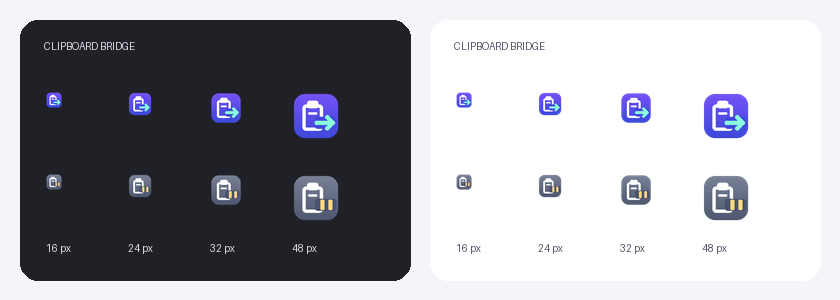

# Clipboard Bridge

Copy on Windows, paste on Android. Copy on Android, tap Send in the app, then paste on Windows. Text and one image at a time, without a persistent Android receiver service.

[中文](README.md) · [Security](SECURITY.md) · [Contributing](CONTRIBUTING.md)

## Features

- Windows tray clipboard monitoring, pause control and `Ctrl+Alt+V` manual sending.
- Android's **发送剪贴板到 Windows** (Send clipboard to Windows) button uploads encrypted text or one image over LAN/Tailscale. Success requires an actual desktop clipboard-write acknowledgment.
- Text, native clipboard images and one copied PNG/JPEG/BMP/GIF file; images are converted to PNG. Maximum content size: 16 MiB.
- AES-256-GCM encrypted content, integrity checks, expiry and sequence protection.
- Separate states for FCM submission and Android clipboard-write acknowledgment.
- LAN access, with optional user-configured Tailscale endpoints.
- Desktop echo suppression prevents received phone content from being automatically sent back. Pausing Windows automatic sending still allows incoming phone transfers.



## Bring your own Firebase project

There is no shared hosted backend or maintainer credential in this repository.

1. Install PowerShell 7+, .NET SDK 10, JDK 21 and Android SDK Platform 36 / Build Tools 36.0.0 on Windows.
2. Clone the repository and build:

```powershell
git clone https://github.com/c01-in/clipboard-bridge.git
cd clipboard-bridge
.\scripts\Build.ps1 -JavaHome 'C:\Tools\jdk-21' -AndroidSdk 'C:\Tools\android-sdk'
# Administrator PowerShell:
.\dist\scripts\Install.ps1
```

3. Create your own Firebase project. Register the Android package **`com.colin.clipbridge`** and download `google-services.json`. Ensure the FCM HTTP v1 API is enabled.
4. Create a dedicated service account in the same project with `roles/firebasecloudmessaging.admin`, generate its JSON key and keep it under `local/credentials/`. Do not put the private key on Android.
5. Install `dist/ClipboardBridge.apk` on Android. In the Windows tray settings, import your service-account JSON and Android Firebase JSON.
6. Configure a reachable computer endpoint, such as `http://<LAN-IP>:45871` or a Tailscale address. Generate a pairing link and confirm it in the Android app; allow notifications.
7. Copy text, wait for acknowledgment and paste on the phone. Then test one image.
8. For the reverse direction, copy text or one image on Android, open the app and tap Send clipboard to Windows. Wait for confirmation, then paste on the computer. Upgrade both sides to 1.1.0+; the Windows tray must be running. Existing pairing remains valid.

The Android Firebase configuration is loaded during pairing, so builds do not require `google-services.json` in the source tree. Keep the same signing key for APK upgrades. Normal operation does not use ADB.

Detailed setup, build and troubleshooting instructions are available in the [Chinese documentation](docs/firebase-setup.md), with links to official Firebase documentation.

## Important limits

- FCM and Google Play services must be available; instant delivery is not guaranteed.
- Longer Windows → Android text, images, acknowledgments and all Android → Windows sends require a reachable LAN or Tailscale connection. Reverse sending does not use FCM. Do not expose port 45871 directly to the public internet.
- One trusted phone per computer. Android sends require an explicit in-app tap; no Android background clipboard monitoring, arbitrary files, multiple images or iOS support.
- A destination app must support image pasting. Force-stopped Android apps need to be opened again before receiving push messages.
- Automatic sync can include sensitive copied text. Pause before copying secrets; pairing links are also secrets.

## Private local data

`local/` and `dist/` are ignored by Git. Runtime credentials and pairing live in `local/runtime/`; APK signing lives in `local/signing/`; original Firebase JSON files belong in `local/credentials/`.

Runtime Windows configuration uses machine-bound DPAPI plus filesystem permissions; Android pairing uses Keystore protection. Ignoring a file is not encryption. Read [SECURITY.md](SECURITY.md) before backing up or publishing files.

## Checks

```powershell
dotnet run --project .\windows\Tests\Tests.csproj -c Release
.\android\gradlew.bat -p .\android assembleDebug lintDebug
.\scripts\Check-Publish.ps1 -IncludeHistory
```

CI builds and checks the code without Firebase credentials. Live delivery and actual pasting require your own configured devices and are not implied by a passing CI build.

## License

[MIT](LICENSE): free to use, modify and redistribute, including commercial use, with the license notice retained. Third-party dependencies keep their own licenses; see [THIRD_PARTY_NOTICES.md](THIRD_PARTY_NOTICES.md).
