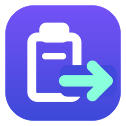

# Clipboard Bridge



Windows 复制，Android 直接粘贴；Android 复制后，在 App 点击发送，Windows 即可粘贴。支持文字和单张图片，手机不需要运行常驻接收服务。

[English](README.en.md) · [配置 Firebase](docs/firebase-setup.md) · [构建与安装](docs/build.md) · [问题排查](docs/troubleshooting.md) · [安全说明](SECURITY.md)

## 功能

- 同一 Wi-Fi 自动发现手机与电脑，无需输入 IP、链接或开启调试；核对六位确认码后，在两端点击确认。
- 跟随系统语言：英语、简体中文、繁体中文、西班牙语、葡萄牙语、法语、德语、日语、韩语；其他语言回退英语。Windows 界面也支持这些语言。
- Windows 托盘自动监听剪贴板；可暂停自动同步，或用 `Ctrl+Alt+V` 手动发送。
- Android 打开 App，点击“发送剪贴板到 Windows”，通过局域网或 Tailscale 加密上传；电脑确认实际写入后才显示成功。不会在后台监听手机剪贴板。
- 支持文字、原生剪贴板图片及复制的单个 PNG/JPEG/BMP/GIF 图片文件。图片转换为单张 PNG，内容上限 16 MiB。
- Android 通过 Firebase Cloud Messaging 唤醒并写入系统剪贴板。每次同步显示普通结果通知，无持续运行的接收前台服务。
- 剪贴板内容使用 AES-256-GCM 加密；手机检查有效期、序号和 SHA-256。
- Windows 区分“已提交 FCM”和“手机已确认写入”；失败重试，过期内容不会继续覆盖新剪贴板。
- 局域网直连，也可使用自己配置的 Tailscale 地址。
- 手机发来的内容不会被 Windows 自动发回，避免同步回环。暂停 Windows 自动发送不影响接收手机手动发送的内容。


## 开始使用

**这是自托管工具。每位使用者使用自己的 Firebase 项目，仓库不提供维护者的 Firebase 配置或私钥。**

1. 按 [构建文档](docs/build.md) 准备 Windows、.NET 10、JDK 21 和 Android SDK 36，然后运行 `scripts/Build.ps1`。
2. 管理员 PowerShell 执行 `dist/scripts/Install.ps1`，在手机安装 `dist/ClipboardBridge.apk`。
3. 按 [Firebase 配置文档](docs/firebase-setup.md) 创建自己的项目、注册 `com.colin.clipbridge`，取得 Android 配置和专用发送账号 JSON。
4. 首次部署在托盘“高级设置”导入这两个配置。打开手机 App 和电脑设置，连接同一 Wi-Fi；选择自动发现的设备，核对两端六位确认码，各点击确认。允许手机通知与系统要求的本地网络权限。
5. 复制文字，等手机确认后实际粘贴；再测试一张图片。
6. 反向发送：在手机复制文字或单张图片，打开 App 点“发送剪贴板到 Windows”，看到 Windows 确认后在电脑粘贴。两端都需升级到 1.1.0+，电脑托盘程序必须运行；已有配对可继续使用。

```powershell
git clone https://github.com/c01-in/clipboard-bridge.git
cd clipboard-bridge
.\scripts\Build.ps1 -JavaHome 'C:\Tools\jdk-21' -AndroidSdk 'C:\Tools\android-sdk'
# 管理员 PowerShell
.\dist\scripts\Install.ps1
```

安装、配对和正常使用均不依赖 ADB。Windows 设置中的“安装或更新手机 App”提供下载二维码，手机扫码后按系统提示安装，再打开 App 自动发现电脑；这个二维码只用于下载安装包。

## 网络与限制

- FCM 需要可用的 Google Play 服务和 Google 网络，不能保证每条消息立即送达。系统后台限制可能导致延迟；强行停止 App 后需手动打开恢复。
- Windows 发往 Android 的短文字可直接包含在加密推送中。较长文字、图片、回执，以及 Android 主动发送，都需要手机通过局域网或 Tailscale 访问电脑 TCP 45871。
- 当前支持一台 Windows 电脑和一台受信任手机双向传输，手机端需点击发送。不支持 Android 后台自动监听、iOS、任意文件或多图同步。
- 图片粘贴取决于目标 App 是否支持图片剪贴板。
- 公开源码不等于零配置，也不等于所有 Google 产品免费；是否启用其他产品及相关费用由各使用者自行决定。

## 私密文件放在哪里

```text
clipboard-bridge/
├─ windows/              Windows 源码
├─ android/              Android 源码与 Gradle Wrapper
├─ scripts/              构建、安装、迁移与发布检查
├─ docs/                 配置、构建与排错文档
├─ dist/                 本机构建产物，不提交 Git
└─ local/                整个目录不提交 Git
   ├─ runtime/           加密发送凭据、设备配对与备份
   ├─ signing/           APK 签名密钥与受保护密码
   └─ credentials/       自己的 Firebase 原始配置
```

Windows 程序安装在 `%ProgramFiles%\ClipboardBridge`。从源码仓库安装时，服务使用 `local/runtime/`，升级保留已有数据路径与签名密钥。移动仓库前先停止服务并按新路径重新安装。

不要公开 `local/`、服务账号文件、签名密钥或旧版本的配对链接。DPAPI 保护依赖原 Windows 环境，重装或换电脑前需按自己的安全流程备份。详见 [安全说明](SECURITY.md)。

## 开发与验证

```powershell
dotnet run --project .\windows\Tests\Tests.csproj -c Release
.\android\gradlew.bat -p .\android assembleDebug lintDebug
.\scripts\Check-Publish.ps1 -IncludeHistory
```

旧版本本地验证过 Windows 原生剪贴板读取、真实 FCM 投递、Android 写入与回执，以及文字和图片实际粘贴。2.0.0 新增自动发现、多语言和双方确认配对；协议检查直接编译 Android Java 密钥协商代码，与 Windows 验证相同密钥及确认码，并检查未批准、伪造确认、重试、替换旧密钥和全部语言占位符。CI 构建、lint 和协议检查不使用真实 Firebase 凭据，不代表新配对流程已通过真机测试。协议细节见 [传输协议](docs/protocol.md)。

1.1.0 已在三星真机验证 App 按钮反向发送 Unicode 文字与单张 PNG：Windows 读取结果一致，图片尺寸、抽样像素和原始 PNG 字节一致，且接收后未触发自动回环发送。

没有完成全部 Android 版本、厂商、长时间锁屏和跨网组合测试。欢迎按 [贡献指南](CONTRIBUTING.md) 提供可复现反馈。

## 许可证

[MIT](LICENSE)。可以免费使用、修改和分发，也允许商业使用；分发时保留许可证和版权声明。第三方组件遵循各自许可证，见 [组件说明](THIRD_PARTY_NOTICES.md)。
