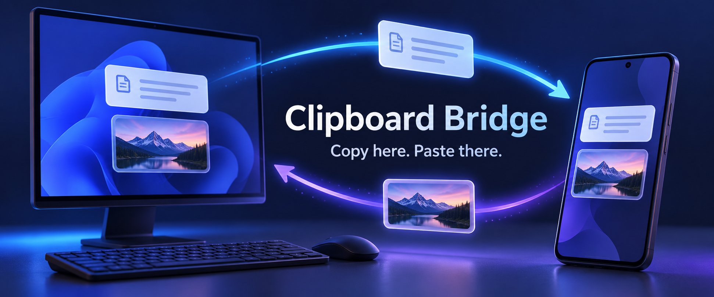
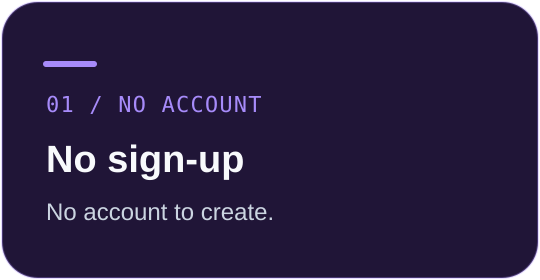
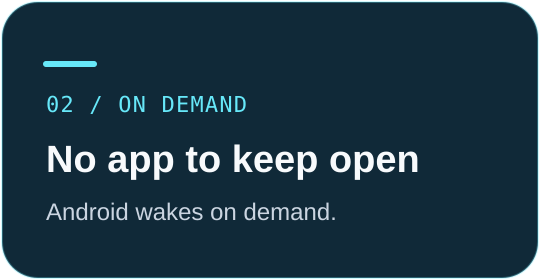
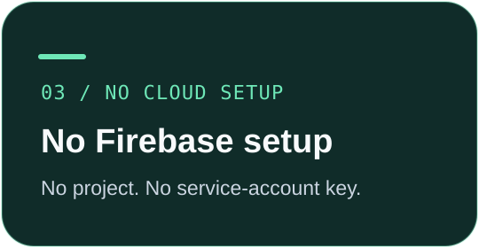

# Clipboard Bridge

**Windows → Android, automatically. Android → Windows, with a tap.**

Text and one image for your clipboard. Photos, videos and documents as files.
Your own devices. Free and open source.

[English](README.md) · [简体中文](README.zh-CN.md) · [Downloads](#download-and-try-it) · [Quick start](#install-pair-copy) · [Docs](#build-and-contribute)

AI-generated concept illustration above; not an app screenshot.

  
  
  

> [!IMPORTANT]
> **Still powered by Google FCM.** No sign-up or Firebase setup does **not** mean Google-free: Android needs working Google Play Services, and both devices need Google network access. **Regions or networks without access to Google are currently unsupported.** Google Play Services handles wake-ups; the Android app needs no permanent foreground service or app-owned connection. Active file transfers use a temporary progress notification and foreground work, which stop afterward.

## Download and try it

**Install both. Pair once. Start copying.**

[0.2.1 installers, library sources & SHA-256 checksums](https://github.com/c01-in/clipboard-bridge/releases/tag/v0.2.1)

**Current release: 0.2.1 preview.** No SDKs, local builds or phone debugging needed. The Microsoft Store edition requires Windows 11 or later, x64. Android requires Android 8.0 or later and Google Play Services. Google Play updates appear after Google's review.

| Windows download | What you get |
| --- | --- |
| [Full installer — MSIX, x64](https://github.com/c01-in/clipboard-bridge/releases/download/v0.2.1/ClipboardBridge-Windows-x64.msix) | Complete 0.2.1 Store edition, Microsoft-signed, including one shared .NET runtime. No application or runtime downloads during installation. |
| [Online installer — EXE](https://github.com/c01-in/clipboard-bridge/releases/download/v0.2.1/ClipboardBridge-Windows-Store-Setup.exe) | Small Microsoft-signed installer; downloads the current [Microsoft Store](https://apps.microsoft.com/detail/9PJT9PTSMCJQ) version. Requires Internet access and Store components. |

Both options use the same Store identity. No Developer Mode or certificate import is required. Release packages are built on GitHub Actions. The full MSIX retains Microsoft's signature; Actions checks its checksum against Microsoft's HTTPS Store catalog before publication. Earlier standalone GitHub EXEs remain unsigned; new downloads do not use them. See the [code signing policy](CODE_SIGNING_POLICY.md).

## Clipboard for quick copies. Files for everything else.

> [!NOTE]
> **0.2.1 preview — files alongside your clipboard.** Use matching 0.2.1 apps for file transfers. See [version notes](docs/release-notes/v0.2.1.md), [file-transfer behavior](docs/file-transfers.md) and [Microsoft Store](https://apps.microsoft.com/detail/9PJT9PTSMCJQ).

| | What you get |
| :--- | :--- |
| **🖥️ Copy on Windows** | Text or one image is sent automatically. Prefer control? Use `Ctrl+Alt+V` or the tray menu. |
| **📱 Share through Clipboard Bridge** | Use another app's Share menu. One image goes to the computer clipboard; shared plain text asks for an explicit Send tap. Or send text/one image from the foreground app's clipboard action. |
| **📁 Send files both ways** | Send multiple photos, videos, documents or other files. Android uses the system picker or Share menu; Windows offers a tray picker, **Share → Clipboard Bridge**, and the desktop edition's classic **Send to** menu. |
| **📂 Choose where files land** | Windows saves to Downloads by default; change the receiving folder in Settings. Android saves to Downloads/Clipboard Bridge on Android 10+, or a chosen folder. Files keep their original bytes and stay out of the clipboard. |
| **📊 See the actual result** | File sending shows progress and waits for a saved-file receipt. The Windows sending window closes three seconds after success; errors and cancellations stay visible. |
| **🔗 Pair without typing** | Find the computer on the same Wi-Fi, compare the six-digit code and confirm on both devices. No IP address or pairing link to enter. |
| **⏸️ Pause when you want** | Pause automatic Windows sending from the tray, or pause new sending and receiving on Android without losing your pairing. |
| **🔐 Keep content encrypted** | Clipboard content uses AES-GCM. Pairing keys and the computer's push identity stay local. Google can still observe push metadata. |
| **🌍 Use your language** | Both apps follow the system language, with nine supported locales and English as the fallback. |

Clipboard mode supports UTF-8 text and **one image, up to 16 MiB**; images travel as PNG. Android image paste support depends on the receiving app. File mode accepts **1–1,000 files per batch** without that 16 MiB clipboard limit. Storage, connectivity and Android background limits still apply. Folders are not supported.

### Pick the destination, not just the content

| Send action in 0.2.1 | Destination |
| --- | --- |
| Android **Send clipboard** or **Send one image to clipboard** | Computer clipboard: text or exactly one image |
| Share one image from another Android app through **Clipboard Bridge** | Computer clipboard |
| Android **Send files…**, even with one image selected | Computer receiving folder |
| Share multiple images, a video or a file attachment from Android | Computer receiving folder |
| Windows system Share panel, tray file picker or desktop **Send to** | Android storage |

Files are not opened automatically. Existing destination files are not overwritten. See [storage, progress, cancellation and limits](docs/file-transfers.md).

## Install. Pair. Copy.

1. **Install both apps.** Open Windows settings from the Start menu and launch Android. Connect both to the same Wi-Fi and allow notifications through the Android prompt.
2. **Confirm your devices.** Select the discovered computer on Android, compare the six-digit code on both screens and confirm on both. Do not approve a different code.
3. **Try your clipboard.** Copy text or one image on Windows, then paste on Android. For the other direction, copy and use the foreground Android app's Send clipboard action, or share through **Clipboard Bridge**. In 0.2.1, shared plain text also requires a Send tap. Success appears after Windows actually writes the clipboard and acknowledges it.

With matching 0.2.1 apps, use **Send files…** or system Share for files. On Windows, set **Save received files to → Change folder…** in Settings. Sending one image through the file picker saves a file; the dedicated image-to-clipboard entry accepts only one image. No custom file browser or broad storage permission is needed.

Need the companion? Android's **Get the Windows app** entry lets you copy/share the [GitHub Releases page](https://github.com/c01-in/clipboard-bridge/releases) and open it on your computer.

No app account, Firebase project, credential import or debug mode is required for normal use. Notification prompts, pairing confirmation and any Android installation permission still need your approval.

> [!TIP]
> **Start on the same Wi-Fi.** Clipboard content travels directly between your devices when needed. No additional networking app is required for normal local use. Google connectivity is still required.

## Push without a project to manage

Windows generates its own VAPID key and sends encrypted Web Push directly to Google. UnifiedPush's embedded receiver uses Google FCM infrastructure and existing Google Play Services to wake Android when needed.

**No maintainer relay. No shared sender secret. No Firebase service-account file.**

Long text and images are fetched directly from Windows over your local network. Initial discovery requires the same Wi-Fi broadcast domain. This transport does not repair Google connectivity failures. See [push and migration](docs/webpush.md).

<strong>Optional: using your devices across networks</strong>

For cross-network use, an existing private network such as Tailscale can carry the direct connection. Add the computer's reachable private-network address in advanced settings before leaving the LAN. This is optional and is not needed when both devices use the same Wi-Fi. Google connectivity is still required.

<strong>Pause behavior & Android permissions</strong>

- **Windows tray pause** affects automatic Windows sending only. Manual sending and receiving from Android remain available.
- **Android's Clipboard sync switch** pauses new sending and receiving without deleting pairing. The choice persists across app and device restarts.
- **Resume starts a fresh receive session.** Previously queued updates are discarded instead of overwriting the clipboard later. Sending becomes available after the computer confirms registration.

Android shows status, the sync switch and Send, plus pairing when needed. Change computer, Reconnect and About are in the overflow menu. Notification permission is requested in the app; system settings are needed only after a permanent denial or disabled channel.

<strong>Nine system languages</strong>

English · 简体中文 · 繁體中文 · Español · Português · Français · Deutsch · 日本語 · 한국어

Both apps follow the system language. Other languages fall back to English.

<strong>Upgrading, privacy & licenses</strong>

The current Android APK is 0.2.1. The Windows Store update appears after Microsoft certification. File features require matching endpoints. Android internal version codes keep increasing and the existing signing key is reused. Update both apps and open Android once. Legacy Firebase configuration is preserved locally in `configuration.pre-webpush.dpapi` and is no longer used for push.

The Microsoft Store edition has separate, per-user encrypted state from the standalone Windows service edition. Back up existing configuration and re-pair when switching editions; do not run both Windows brokers on the same port. The Store package needs neither administrator elevation nor a separate .NET installation. All Windows components share one bundled .NET runtime.

Keys, subscription endpoints and runtime data stay local and are excluded from source and public installers. Clipboard content is AES-GCM encrypted, but Google can observe push metadata. Use trusted local or private networks. See [SECURITY.md](SECURITY.md).

Our code is [MIT](LICENSE). The embedded UnifiedPush receiver retains LGPL-2.1; the connector uses Apache-2.0. Both full licenses are inside the APK and original library sources accompany each Release. See [third-party notices](THIRD_PARTY_NOTICES.md). Version 0.1.2 corrects the license packaging in 0.1.1 without changing delivery behavior.

## Tested, with limits stated

**112 Windows automated checks pass**, covering protocol, IPC, pairing, Web Push, file chunks and destination writes, pause revision, migration, licenses, locales and actual HTTP downloads. File interoperability also has **20 Android instrumentation tests**; these counts describe the current preview, not a blanket device-certification claim.

- **Native push probe:** six short messages arrived, including process termination and forced deep Doze. [Probe evidence](experiments/webpush-probe/RESULTS.md)
- **Production device tests:** pairing migration, persistent pause, obsolete-session rejection, and text/image transfers in both directions passed. [Device evidence](docs/verification-0.1.1.md)
- **Android sharing:** 12 emulator checks passed, including separate-app image URI grants and no duplicate submission after activity recreation. The reported second WeChat copy toast is still unattributed. [Sharing verification](docs/android-sharing.md)
- **File transfers:** real encrypted C#/Android transfers, destination hashes, empty and larger-than-clipboard-limit files, cancellation and retries were exercised on an emulator. New file wake-ups through Google on every vendor/device are not established by those tests. [File verification](docs/file-transfers.md#verification)
- **Store packaging and API:** full MSIX validation, one shared CLR, real per-user broker/IPC, complete Android companion download, and real Store OAuth/read access passed. Store certification passed and the app is published; complete Store-delivered installation/update testing remains separate. [Store workflow](https://github.com/c01-in/clipboard-bridge/actions/workflows/microsoft-store.yml)

All vendors, prolonged sleep, reboot recovery and cross-network combinations have **not** been validated. This is a preview, not a guarantee of long-term delivery.

## Build and contribute

| Start here | Read more |
| :--- | :--- |
| [Build, install & uninstall](docs/build.md) | [Protocol](docs/protocol.md) |
| [GitHub Actions releases](docs/releases.md) | [Troubleshooting](docs/troubleshooting.md) |
| [Contributing](CONTRIBUTING.md) | [Security](SECURITY.md) |
| [Google Play readiness](docs/google-play.md) | [Privacy policy](PRIVACY.md) |
| [File transfers](docs/file-transfers.md) | [Windows Share](docs/windows-sharing.md) |
| [Microsoft Store](docs/microsoft-store.md) | [0.2.1 notes](docs/release-notes/v0.2.1.md) |

GitHub Actions builds and tests both apps. Store API authentication is configured; automatic Store updates remain gated until the first publication completes. Standalone signed EXE publication separately requires approved SignPath access, which is not configured. A green CI run, GitHub Release or uploaded package does not mean a store has approved the app. See [release channels and prerequisites](docs/releases.md).

---

**One clipboard bridge. Two devices.**

[Download the preview](#download-and-try-it) · [Report an issue](https://github.com/c01-in/clipboard-bridge/issues) · [Read the Chinese guide](README.zh-CN.md)

