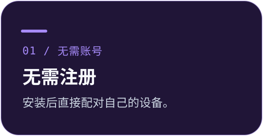
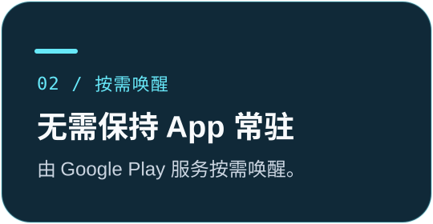
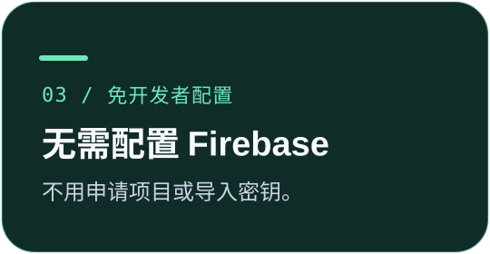

# Clipboard Bridge · 剪贴板同步

> **0.2.2 预览版：多文件互传，Windows 微软商店版已上线。** Android 通过系统选择器或分享菜单发送多张图片、视频及文件；Windows 可设置接收文件夹，也支持托盘和系统“共享 → 剪贴板同步”。两端显示进度，剪贴板模式仍限文字或单张图片。详见[版本说明](docs/release-notes/v0.2.2.md)。

**Windows 自动发送，Android 点击发送。**

文字、单张图片进剪贴板；多张图片、视频和文档保存为文件。免费、开源。

[English](README.md) · [简体中文](README.zh-CN.md) · [下载安装](#下载安装) · [快速上手](#安装配对开始复制) · [开发文档](#开发与贡献)

[Android · Google Play](https://play.google.com/store/apps/details?id=com.colin.clipbridge) · [Windows · 微软商店](https://apps.microsoft.com/detail/9PJT9PTSMCJQ)

上方为 AI 生成的概念插画，并非 App 实际界面截图。

  
  
  

> [!IMPORTANT]
> **仍然依赖 Google FCM。** 免注册、免 Firebase 配置不代表不依赖 Google：手机需要可用的 Google Play 服务，两端需要 Google 网络连接。**无法访问 Google 的地区或网络环境暂不支持。** Android App 无需常驻前台服务或自建长连接，由 Google Play 服务负责唤醒。

## 下载安装

**安装两端，确认配对，开始复制。**

[0.2.2 安装包、库源码与 SHA-256 校验值](https://github.com/c01-in/clipboard-bridge/releases/tag/v0.2.2)

**当前版本：0.2.2 预览版。** 普通用户无需 SDK、自行 build 或开启手机调试。微软商店版需要 Windows 11 或更新版本、x64；Android 需要 Android 8.0 或更新版本及 Google Play 服务。Google Play 更新需等待 Google 审核。

| Windows 下载 | 安装方式 |
| --- | --- |
| [完整安装包 — MSIX，x64](https://github.com/c01-in/clipboard-bridge/releases/download/v0.2.2/ClipboardBridge-Windows-x64.msix) | 完整 0.2.2 商店版，保留微软签名，包含一份共用的 .NET 运行环境。安装时无需再下载程序或运行环境。 |
| [在线安装器 — EXE](https://github.com/c01-in/clipboard-bridge/releases/download/v0.2.2/ClipboardBridge-Windows-Store-Setup.exe) | 微软签名的小安装器，联网下载当前[微软商店](https://apps.microsoft.com/detail/9PJT9PTSMCJQ)版本，需要可用的商店组件。 |

两者使用同一商店身份，均无需开发者模式或导入证书。发布包由 GitHub Actions 构建；完整 MSIX 会在对应版本通过微软认证、核对官方校验值后上传 Release。在此之前，在线安装器下载商店当前已发布的版本。旧版独立 EXE 仍未签名，新下载入口不使用它，见[代码签名政策](CODE_SIGNING_POLICY.md)。

## 剪贴板快速复制，文件直接保存

以下为 0.2.2 功能。Android 空闲时无需常驻；文件传输期间会临时运行前台任务并显示进度通知，结束后停止。

| | 你可以做什么 |
| :--- | :--- |
| **🖥️ Windows 复制即发送** | 自动发送文字或单张图片；也可使用 `Ctrl+Alt+V` 或托盘菜单手动发送。 |
| **📱 通过 App 分享** | 在其他 App 的分享菜单选择“发送到电脑”：单张图片进入电脑剪贴板，纯文字需再点击发送；也可在前台 App 内发送剪贴板。 |
| **📁 多文件双向互传** | 手机调用系统选择器或分享菜单；电脑支持托盘选择、系统共享面板和桌面版“发送到”菜单。支持图片、视频、文档及其他文件，暂不支持文件夹。 |
| **📂 自选保存路径** | Windows 默认保存到下载文件夹，在“设置 → 接收文件保存到 → 更改文件夹”修改；Android 10+ 默认保存到 Downloads/Clipboard Bridge，也可选定文件夹。 |
| **📊 进度与保存回执** | 接收方实际保存并确认后才成功；Windows 发送成功窗口三秒后关闭，错误和取消仍保留提示。 |
| **🔗 配对不用输入** | 在同一 Wi-Fi 自动发现电脑，比较六位确认码并在两端确认，无需输入 IP 或配对链接。 |
| **⏸️ 随时暂停** | Windows 托盘可暂停自动发送；Android 可暂停新的收发，并保留配对。 |
| **🔐 内容加密传输** | 剪贴板采用 AES-GCM 加密。配对密钥和电脑推送身份保存在本地；Google 仍可看到推送元数据。 |
| **🌍 跟随系统语言** | 两端支持九种语言，其余语言回退英语。 |

剪贴板支持 UTF-8 文字或**单张图片，正文最大 16 MiB**；图片按 PNG 传输，Android 粘贴取决于目标 App。文件模式每批支持 **1–1,000 个文件**，原始字节不转换，不写入剪贴板，不受上述 16 MiB 上限限制，仍受存储、连接时长及 Android 后台限制影响。

**发送规则：** “打开方式 → 发送到电脑”始终保存为文件，包括单张图片或文字文档。三星系统面板会在“发送到电脑”上方同时显示应用名。文件传输改用电脑签发、电脑计时的会话，无需两端对时；剪贴板消息原有的过期检查保留。 手机专门的图片剪贴板入口只能选择一张；从其他 App 分享单张图片也进电脑剪贴板。“发送文件”入口即使只选一张图片也保存为文件；分享多张图片、视频及其他附件同样保存为文件。Windows 系统共享、托盘文件选择和桌面版“发送到”都保存到手机存储。收到的文件不会自动打开，不会覆盖已有同名文件。详见[文件传输说明](docs/file-transfers.md)。

## 安装、配对、开始复制

1. **安装两端。** 从开始菜单打开 Windows 设置，再打开手机 App。连接同一 Wi-Fi，按手机内的引导允许通知。
2. **确认设备。** 手机选择自动发现的电脑，比较两端显示的六位确认码，并在两端确认。确认码不同就不要批准。
3. **试一次复制。** Windows 复制文字或单张图片，在 Android 粘贴。反向可复制后打开 App 发送，或在系统分享菜单选择“发送到电脑”；0.2.2 分享纯文字还需点击发送。只有 Windows 实际写入并返回确认，手机才显示成功。

还没安装电脑端？Android 的**获取 Windows 版**入口可复制或分享 [GitHub Releases 页面](https://github.com/c01-in/clipboard-bridge/releases)，在电脑上打开后自行选择安装包。

正常使用无需注册 App 账号、申请 Firebase 项目、导入凭据或开启调试模式。通知授权、配对确认和 Android 安装权限仍需用户同意。

> [!TIP]
> **先在同一 Wi-Fi 使用。** 需要时，剪贴板内容直接在两台设备之间传输。正常局域网使用无需安装额外的组网软件，Google 网络仍然必需。

## 推送不用自己申请项目

Windows 自动生成自己的 VAPID 密钥，直接向 Google 发送加密 Web Push。UnifiedPush 嵌入式接收库使用 Google FCM 基础设施，由现有 Google Play 服务按需唤醒 Android。

**无需我们维护的中转服务器，无共享发送密钥，无 Firebase 服务账号文件。**

长文字和图片直接通过局域网从电脑下载。首次发现要求同一 Wi-Fi 广播域。这条通道不能修复 Google 网络连接故障，见 [推送与升级说明](docs/webpush.md)。

<strong>可选：跨网使用</strong>

跨网时，可借助已有的私有网络（例如 Tailscale）承载直连通道。离开局域网前，在电脑高级设置中添加电脑可达的私有网络地址。这只是可选方案，两端在同一 Wi-Fi 时不需要安装。Google 网络仍然必需。

<strong>暂停行为与 Android 权限</strong>

- **Windows 托盘暂停**只影响电脑自动发送，仍可手动发送和接收手机内容。
- **Android“剪贴板同步”开关**暂停手机的新收发，保留配对；状态在退出和重启后保留。
- **恢复时建立新接收会话。** 旧排队消息不会补写剪贴板；电脑确认注册后，手机才恢复发送。

手机界面保留状态、同步开关、发送和必要的配对引导；更换电脑、重新连接、关于位于更多菜单。通知权限在 App 内请求；系统不再允许弹窗或通知通道被关闭时，才引导到系统设置。

<strong>九种系统语言</strong>

English · 简体中文 · 繁體中文 · Español · Português · Français · Deutsch · 日本語 · 한국어

两端跟随系统语言，其余语言回退英语。

<strong>升级、隐私与许可证</strong>

当前 Android APK 为 0.2.2；Windows 商店更新需等待微软认证。文件功能要求两端匹配。Android 内部升级编号持续递增并沿用原签名。更新两端后打开手机 App 一次。旧 Firebase 配置保存在 `configuration.pre-webpush.dpapi` 加密备份中，不再用于推送。

微软商店版使用独立的每用户加密配置。切换渠道前保留备份并重新配对，不要同时运行两个占用相同端口的 Windows 后台。商店版无需管理员系统服务或另装 .NET；Windows 组件共用随包附带的一份运行环境。

凭据、配对密钥、接收地址和运行数据保存在本地，不进入公开仓库或安装包。不要分享私密文件。剪贴板内容使用 AES-GCM 加密，Google 仍可看到推送元数据。请只在受信任的局域网或私有网络内使用，见 [SECURITY.md](SECURITY.md)。

项目自己的代码采用 [MIT](LICENSE)。UnifiedPush 接收库保留 LGPL-2.1，connector 使用 Apache-2.0；两份完整许可证包含在 APK 中，原始库源码随 Release 提供，见 [第三方组件说明](THIRD_PARTY_NOTICES.md)。0.1.2 修正了 0.1.1 的许可证打包标记，收发逻辑不变。

## 有验证，也有明确的限制

当前预览版 **112 项 Windows 自动检查通过**，覆盖协议、IPC、配对、Web Push、文件分块与保存、暂停修订号、迁移、许可证、语言及 HTTP 下载；另有 **20 项 Android 文件互传测试**。这些结果不等于所有实机都已验证。

- **原生推送探针：** 6 条短时消息到达，含进程终止和强制深度 Doze。[探针记录](experiments/webpush-probe/RESULTS.md)
- **正式版实机测试：** 原配对迁移、暂停持久化、旧会话拒收、文字与图片双向收发通过。[实机记录](docs/verification-0.1.1.md)
- **Android 快捷分享：** 12 项模拟器检查通过，包含其他 App 的图片 URI 授权和屏幕重建后不重复发送。微信里第二条复制 Toast 的来源仍未确认。[分享验证](docs/android-sharing.md)
- **文件互传：** 模拟器验证真实加密传输、保存后的哈希、空文件、大文件、取消和重试；不代表所有实机 Google 文件唤醒均已验证。[文件测试](docs/file-transfers.md#verification)
- **商店打包：** MSIX、共用 CLR、真实每用户后台与 IPC、完整 APK 下载与哈希及微软 API 检查已通过。商店认证通过且已发布；完整的商店安装及更新验证另行记录。[商店流程](docs/microsoft-store.md)

**尚未**验证所有 Android 厂商、长期锁屏、重启恢复及所有跨网组合。预览版不保证长期投递表现。

## 开发与贡献

| 从这里开始 | 更多说明 |
| :--- | :--- |
| [构建、安装与卸载](docs/build.md) | [协议](docs/protocol.md) |
| [GitHub Actions 发布](docs/releases.md) | [故障排查](docs/troubleshooting.md) |
| [贡献指南](CONTRIBUTING.md) | [安全](SECURITY.md) |
| [Google Play 发布评估](docs/google-play.md) | [隐私政策](PRIVACY.md) |
| [文件互传](docs/file-transfers.md) | [Windows 系统共享](docs/windows-sharing.md) |
| [微软商店](docs/microsoft-store.md) | [0.2.2 版本说明](docs/release-notes/v0.2.2.md) |

GitHub Actions 自动构建和检查两端。微软商店 API 已配置，首次上架完成前自动提交更新仍关闭。独立签名 EXE 的发布另需 SignPath 批准和凭据，目前未配置。CI、GitHub Release 或上传成功都不等于商店审核通过，详见[发布渠道](docs/releases.md)。

---

**一个剪贴板桥梁，连接两台设备。**

[下载预览版](#下载安装) · [反馈问题](https://github.com/c01-in/clipboard-bridge/issues) · [English guide](README.md)

